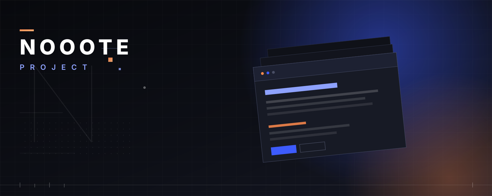

  

---

**Docs**　[Quick start](docs/QUICK_START.md) · [Features & UI](docs/FEATURES.md) · [Markdown extensions](docs/MARKDOWN.md) · [HTTP API](docs/API.md) · [Configuration](docs/CONFIGURATION.md) · [Project structure](docs/PROJECT_STRUCTURE.md)

**More**　[Contributing](CONTRIBUTING.md) · [Code of conduct](CODE_OF_CONDUCT.md) · [Security](SECURITY.md) · [License](LICENSE) · [中文](README.md)

