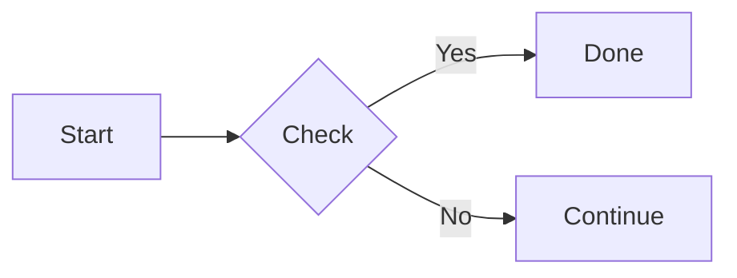

# Nooote

[](https://github.com/chengzi404-hash/nooote/actions/workflows/ci.yml)
[](LICENSE)
[](https://www.python.org/)
[](https://flask.palletsprojects.com/)

[中文](README.md) | **English**

A lightweight online Markdown notes app: sign up and log in to create and edit private notes that autosave as you type. Publish a note to share it through a read-only `/share/<note_id>` link. The public page and the private note share the same content, so edits to the private note sync automatically.

## Features

- `GET /console`: your console, managing the private notes of your account
- User system: registration, login, and logout, with passwords stored as Werkzeug hashes; the console, settings, notes API, and attachment management require login
- `GET /console/settings`: user settings for nickname, theme (system/light/dark), and whether new notes are public by default
- `GET /console/attachments`: image hosting and attachment manager to upload, copy links, and delete files
- Upload images from the editor by button, drag-and-drop, or paste; Markdown is inserted automatically
- Images render inline via `/files/<id>`; other files are served as downloads. Attachment links are unguessable, but anyone with the link can access them, so do not upload sensitive files
- Private notes are visible only to you and can be published or unpublished at any time
- Published notes are read-only at `/share/<note_id>`, with no editing UI
- Public pages update automatically from the private note; only editing the private note can change them
- Editor on the left, live preview on the right, with autosave as you type
- Code block syntax highlighting (highlight.js, common languages, light/dark themes switch automatically)
- LaTeX math (KaTeX): inline `$...$`, block `$$...$$`, common LaTeX syntax supported
- GitHub-style alert cards (Note, Tip, Important, Warning, Caution) and GFM task list styling
- Mermaid diagrams previewed inline: `mermaid` code blocks render as flowcharts, sequence diagrams, class diagrams, state diagrams, ER diagrams, Gantt charts, pie charts, and more
- Static checks for code blocks in multiple languages: JavaScript, Python, C/C++, Rust, Ruby, HTML, CSS, JSON, Java, PHP, Go, YAML, with ✅/❌ in the top-right corner; click to expand line/column numbers and error details
- The checker loads on demand in the browser (Lezer parsers plus Ruby's official Prism WASM), and never uploads your code
- Checks are parse-based and focus on syntax/structural errors; they are not a complete lint rule set for each language
- Autosave after you pause typing; `Ctrl / ⌘ + S` saves immediately
- Recently published notes and a random published note entry point
- Dark mode, stacked panes on mobile
- Raw HTML in Markdown is sanitized by DOMPurify before rendering, and the CSP allows only same-origin scripts and styles

## Interface

- The home page is a project introduction: a banner header image, capability cards, a three-step workflow, the tech stack, and recently published notes
- The console uses a persistent sidebar: new note, note/attachment navigation, note statistics, and account actions
- Square controls: only primary buttons use the theme-colour fill; secondary buttons keep a plain border. Every button and input has an expanding focus animation
- Pages animate on entry, and browsers with View Transitions get a cross-navigation fade

## Running

This project uses [uv](https://docs.astral.sh/uv/) for dependency management:

```bash
uv sync
uv run flask --app main run --debug
```

Or run it directly:

```bash
uv run python main.py
```

Open <http://127.0.0.1:5000>, register or log in, then open "My console" to create a private note; share it read-only at `/share/<note_id>` once published.

## Accounts and authentication

| Method | Path | Description |
| --- | --- | --- |
| `GET / POST` | `/register` | Create an account and log in automatically |
| `GET / POST` | `/login` | Log in |
| `POST` | `/logout` | Log out |

Only password hashes are stored; plaintext passwords are never persisted.

## Configuration

| Variable | Default | Description |
| --- | --- | --- |
| `DATABASE_URL` | `sqlite:///notes.db` | Database connection; by default stored at `instance/notes.db` |
| `SECRET_KEY` | auto-generated | Session signing key; generated and saved to `instance/secret_key` when unset |
| `UPLOAD_FOLDER` | `instance/uploads` | Directory for uploaded images and attachments |
| `MAX_UPLOAD_BYTES` | `8 MiB` | Per-file upload size limit |

Note content is limited to 256 KiB (`MAX_NOTE_BYTES`), and request bodies are limited to 10 MiB. Default configuration and shared constants live in `nooote/config.py` and can be overridden in the application factory.

## Math

Use a single dollar sign for inline math and two for display math:

```markdown
The mass-energy equivalence is $E = mc^2$.

$$
\int_0^1 x^2 \, dx = \frac{1}{3}
$$
```

To avoid mistaking currency amounts for formulas, `$` cannot be followed by whitespace, the `$` before the closing delimiter cannot be preceded by whitespace, and the closing `$` cannot be followed by a digit; write `\$` for a literal dollar sign. Math is rendered by KaTeX in the browser and loads no external fonts or resources.

KaTeX needs inline styles, so the CSP allows `'unsafe-inline'` for `style-src`. Inline `style` attributes in raw Markdown HTML are stripped by DOMPurify, keeping only the styles KaTeX generates itself.

## Alerts and Task Lists

GitHub-style alert cards are supported:

```markdown
> [!WARNING]
> This is a warning.

> [!TIP]
> This is a tip.
```

Available types: `NOTE`, `TIP`, `IMPORTANT`, `WARNING`, `CAUTION`. Regular blockquotes are unaffected.

GFM task lists:

```markdown
- [ ] Todo item
- [x] Done item
```

Completed items show a checked state with dimmed, struck-through text.

## Mermaid Diagrams

Render Mermaid code blocks directly in the preview:

````markdown

````

Mermaid loads on demand only when a note contains `mermaid` / `mmd` blocks, runs in strict security mode, and supports Mermaid's built-in diagram types such as flowchart, sequence, class, state, ER, Gantt, pie, and mindmap. Syntax errors appear in an error card in the preview.

## HTTP API

| Method | Path | Description |
| --- | --- | --- |
| `GET` | `/api/console/notes/<note_id>` | Fetch one of your private notes and its publish state |
| `PUT` | `/api/console/notes/<note_id>` | Save one of your private notes; JSON body: `{"content": "..."}` |
| `GET` | `/api/share/<note_id>` | Read a published note (read-only) |
| `POST` | `/api/console/attachments` | Upload an attachment as `multipart/form-data` with a `file` field |
| `DELETE` | `/api/console/attachments/<attachment_id>` | Delete one of your attachments |
| `GET` | `/files/<attachment_id>` | Read an attachment; images inline, other files as downloads |

Published notes have no write endpoint; after editing the private note, `/share/<note_id>` and `/api/share/<note_id>` return the new content immediately. Preview and syntax highlighting run entirely in the browser and do not call any server-side rendering endpoint.

## Testing

```bash
uv run pytest
```

## Project Structure

```
main.py                  # Application entry point
nooote/
├── __init__.py          # App factory, config loading, security headers
├── config.py            # Configuration defaults and shared constants
├── extensions.py        # SQLAlchemy instance
├── models.py            # User (account and password hash), Note, and Attachment models
├── services.py          # Domain logic for users, notes, and attachments
├── blueprints/
│   ├── public.py        # Home, public read-only pages, legacy redirects
│   ├── auth.py          # Registration, login, logout
│   ├── console.py       # Console, private notes, user settings
│   ├── notes_api.py     # Notes JSON API
│   └── attachments.py   # Image hosting, attachment management, file serving
├── templates/           # Home, login/register, console, settings, attachments, editor, share
└── static/              # Styles, browser rendering scripts, icons
    └── vendor/          # marked, highlight.js, DOMPurify, KaTeX, Mermaid, Lezer, Ruby Prism (with licenses)
tools/checks/            # Source and rebuild instructions for static-check bundles
tests/                   # pytest tests
```

## Contributing

Issues and pull requests are welcome. Please read the [contributing guide](CONTRIBUTING.md) and the [code of conduct](CODE_OF_CONDUCT.md) first. If you find a security vulnerability, do not report it publicly; follow the [security policy](SECURITY.md) instead.

## License

[MIT](LICENSE) © 2026 chengzi404-hash
