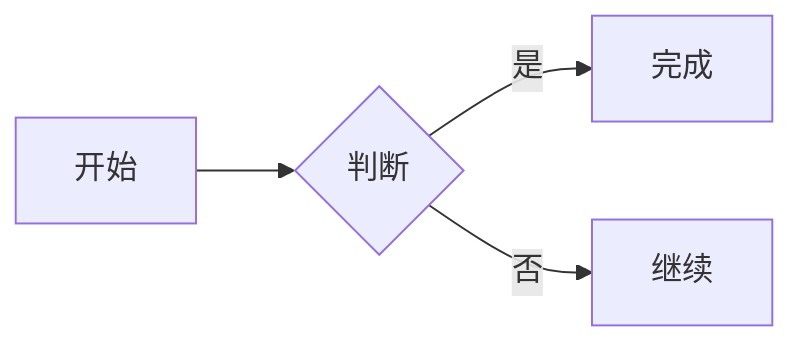

# Nooote

[](https://github.com/chengzi404-hash/nooote/actions/workflows/ci.yml)
[](LICENSE)
[](https://www.python.org/)
[](https://flask.palletsprojects.com/)

**中文** | [English](README.en.md)

一个轻量的在线 Markdown 笔记应用：注册并登录后即可创建和编辑私有笔记，输入时自动保存。把笔记公开后，可通过只读链接 `/share/<note_id>` 分享给任何人。公开页与私有笔记共用同一份内容，修改私有笔记会自动同步更新。

## 功能

- `GET /console`：我的控制台，管理当前账号的私有笔记
- 用户系统：注册、登录、退出，密码使用 Werkzeug 哈希存储；控制台、设置、笔记 API 与附件管理均需登录
- `GET /console/settings`：用户设置，可设置昵称、外观主题（跟随系统/浅色/深色）与新笔记默认公开
- `GET /console/attachments`：图床与附件管理，可上传、复制链接和删除文件
- 编辑器内支持点击上传、拖拽或粘贴图片，自动插入 Markdown 图片或附件链接
- 图片通过 `/files/<id>` 内联显示，其他文件以下载方式提供；附件链接不可猜测，但拿到链接的人都能访问，请勿上传敏感文件
- 私有笔记默认仅自己可见，可随时公开或取消公开
- 公开笔记通过 `/share/<note_id>` 只读访问，页面不提供编辑入口
- 公开页内容随私有笔记自动同步，只有修改私有笔记才能改变公开笔记
- 编辑区与 CommonMark 预览双栏并排，输入时自动保存
- 代码块语法高亮（highlight.js，支持常用语言，浅色/深色主题自动切换）
- LaTeX 数学公式（KaTeX）：行内 `$...$`、行间 `$$...$$`，支持常用 LaTeX 语法
- GitHub 风格提示卡片（Note、Tip、Important、Warning、Caution）和 GFM 任务列表样式
- Mermaid 图表直接预览：`mermaid` 代码块自动渲染为流程图、时序图、类图、状态图、ER 图、甘特图、饼图等
- 多语言代码块静态检查：JavaScript、Python、C/C++、Rust、Ruby、HTML、CSS、JSON、Java、PHP、Go、YAML，右上角显示 ✅/❌，点击展开行号、列号和错误详情
- 检查器在浏览器端按需加载（Lezer 语法解析器 + Ruby 官方 Prism WASM），不会上传代码
- 静态检查基于语法解析，重点报告语法/结构错误，不等同于各语言的完整 lint 规则集
- 输入停顿后自动保存，`Ctrl / ⌘ + S` 可立即保存
- 最近公开的笔记列表、随机公开笔记入口
- 深色模式、移动端上下分栏
- Markdown 原始 HTML 由 DOMPurify 清洗后再渲染，CSP 仅允许同源脚本和样式

## 界面

- 首页是项目介绍页：顶部 Banner 头图、能力卡片、三步工作流、技术栈与最近公开笔记
- 控制台采用固定侧边栏：新建笔记、笔记/附件导航、笔记概览统计与账号操作
- 方形控件体系：只有主按钮使用主题色填充，次要按钮仅保留描边；所有按钮和输入框在聚焦时都有扩散式 focus 动画
- 页面切换带有进入动画，支持浏览器 View Transitions 的页面会在路由之间做淡入淡出

## 运行

本项目使用 [uv](https://docs.astral.sh/uv/) 管理依赖：

```bash
uv sync
uv run flask --app main run --debug
```

或直接运行：

```bash
uv run python main.py
```

打开 <http://127.0.0.1:5000>，注册或登录后进入「我的控制台」新建私有笔记；公开后即可通过 `/share/<note_id>` 只读分享。

## 账号与认证

| 方法 | 路径 | 说明 |
| --- | --- | --- |
| `GET / POST` | `/register` | 注册账号并自动登录 |
| `GET / POST` | `/login` | 登录 |
| `POST` | `/logout` | 退出登录 |

密码只保存哈希值，不会以明文存储。

## 配置

| 变量 | 默认值 | 说明 |
| --- | --- | --- |
| `DATABASE_URL` | `sqlite:///notes.db` | 数据库连接，默认存放在 `instance/notes.db` |
| `SECRET_KEY` | 自动生成 | 会话签名密钥；未设置时自动生成并保存到 `instance/secret_key` |
| `UPLOAD_FOLDER` | `instance/uploads` | 附件与图片的存储目录 |
| `MAX_UPLOAD_BYTES` | `8 MiB` | 单个上传文件的大小上限 |

笔记内容上限为 256 KiB（`MAX_NOTE_BYTES`），请求体上限为 10 MiB。默认配置与共享常量集中在 `nooote/config.py`，可在应用工厂中覆盖。

## 数学公式

行内公式用单个美元符号，行间公式用两个：

```markdown
质能方程 $E = mc^2$。

$$
\int_0^1 x^2 \, dx = \frac{1}{3}
$$
```

为避免把货币金额误识别为公式，`$` 后不能紧跟空白、`$` 前不能有空白，且结束 `$` 后不能紧跟数字；需要字面美元符号时写作 `\$`。公式在浏览器端由 KaTeX 渲染，不读取任何外部字体或资源。

KaTeX 需要内联样式，因此 CSP 对 `style-src` 放开了 `'unsafe-inline'`；Markdown 原始 HTML 中的 `style` 会被 DOMPurify 移除，仅保留 KaTeX 自身生成的样式。

## 提示卡片与任务列表

支持 GitHub 风格的提示卡片：

```markdown
> [!WARNING]
> 这里是警告内容。

> [!TIP]
> 这里是提示内容。
```

可用类型：`NOTE`、`TIP`、`IMPORTANT`、`WARNING`、`CAUTION`。普通块引用不受影响。

GFM 任务列表：

```markdown
- [ ] 待办事项
- [x] 已完成事项
```

已完成项会显示勾选状态、弱化文字并加删除线。

## Mermaid 图表

在预览中直接渲染 Mermaid 代码块：

````markdown

````

Mermaid 仅在笔记包含 `mermaid` / `mmd` 代码块时按需加载，使用严格安全模式，支持 Mermaid 自带的流程图、时序图、类图、状态图、ER 图、甘特图、饼图、思维导图等图表类型。语法错误会显示在预览中的错误卡片里。

## HTTP API

| 方法 | 路径 | 说明 |
| --- | --- | --- |
| `GET` | `/api/console/notes/<note_id>` | 获取自己的私有笔记内容与公开状态 |
| `PUT` | `/api/console/notes/<note_id>` | 保存自己的私有笔记，JSON 请求体：`{"content": "..."}` |
| `GET` | `/api/share/<note_id>` | 读取已公开笔记（只读） |
| `POST` | `/api/console/attachments` | 上传附件，`multipart/form-data`，字段名为 `file` |
| `DELETE` | `/api/console/attachments/<attachment_id>` | 删除自己的附件 |
| `GET` | `/files/<attachment_id>` | 读取附件；图片内联显示，其他文件作为下载 |

公开笔记没有写入接口；编辑私有笔记后，`/share/<note_id>` 与 `/api/share/<note_id>` 会立即返回新内容。预览与代码高亮完全在浏览器端运行，不需要请求服务端渲染接口。

## 测试

```bash
uv run pytest
```

## 项目结构

```
main.py                  # 应用入口
nooote/
├── __init__.py          # 应用工厂、配置加载、安全响应头
├── config.py            # 配置默认值与共享常量
├── extensions.py        # SQLAlchemy 实例
├── models.py            # User（账号与密码哈希）、Note 与 Attachment 模型
├── services.py          # 用户、笔记与附件的领域逻辑
├── blueprints/
│   ├── public.py        # 首页、公开只读页与旧路径重定向
│   ├── auth.py          # 注册、登录与退出
│   ├── console.py       # 控制台、私有笔记与用户设置
│   ├── notes_api.py     # 笔记 JSON API
│   └── attachments.py   # 图床、附件管理与文件读取
├── templates/           # 首页、登录注册、控制台、设置、附件、编辑与公开页
└── static/              # 样式、浏览器端渲染脚本、图标
    └── vendor/          # marked、highlight.js、DOMPurify、KaTeX、Mermaid、Lezer、Ruby Prism（含许可证）
tools/checks/            # 静态检查 bundle 的源码与重建说明
tests/                   # pytest 测试
```

## 贡献

欢迎提交 Issue 和 Pull Request。开始之前请阅读 [贡献指南](CONTRIBUTING.md) 和 [行为准则](CODE_OF_CONDUCT.md)。发现安全漏洞时不要公开提交，请按 [安全策略](SECURITY.md) 私密报告。

## 许可证

[MIT](LICENSE) © 2026 chengzi404-hash
