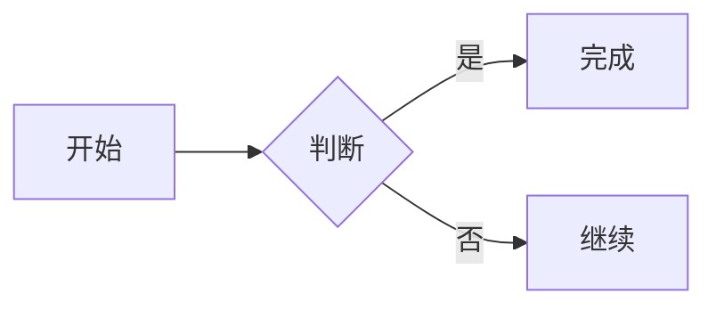

# Nooote

一个轻量的在线 Markdown 笔记应用，类似 [note.ms](https://note.ms)：无需注册，直接打开 `/world/<note_id>` 就能新建或编辑笔记。编辑区与 CommonMark 预览双栏并排，输入时自动保存。

## 功能

- `GET /world/<note_id>`：打开笔记，不存在时自动创建
- 左栏编辑、右栏实时预览，支持 CommonMark，渲染在浏览器端完成
- 代码块语法高亮（highlight.js，支持常用语言，浅色/深色主题自动切换）
- LaTeX 数学公式（KaTeX）：行内 `$...$`、行间 `$$...$$`，支持常用 LaTeX 语法
- GitHub 风格提示卡片（Note、Tip、Important、Warning、Caution）和 GFM 任务列表样式
- Mermaid 图表直接预览：`mermaid` 代码块自动渲染为流程图、时序图、类图、状态图、ER 图、甘特图、饼图等
- 多语言代码块静态检查：JavaScript、Python、C/C++、Rust、Ruby、HTML、CSS、JSON、Java、PHP、Go、YAML，右上角显示 ✅/❌，点击展开行号、列号和错误详情
- 检查器在浏览器端按需加载（Lezer 语法解析器 + Ruby 官方 Prism WASM），不会上传代码
- 静态检查基于语法解析，重点报告语法/结构错误，不等同于各语言的完整 lint 规则集
- 输入停顿后自动保存，`Ctrl / ⌘ + S` 可立即保存
- 最近更新的笔记列表、随机笔记入口
- 深色模式、移动端上下分栏
- Markdown 原始 HTML 由 DOMPurify 清洗后再渲染，CSP 仅允许同源脚本和样式

## 运行

本项目使用 [uv](https://docs.astral.sh/uv/) 管理依赖：

```bash
uv sync
uv run flask --app main run --debug
```

或直接运行：

```bash
uv run python main.py
```

打开 <http://127.0.0.1:5000>，输入任意笔记 ID 即可开始；也可以直接访问 <http://127.0.0.1:5000/world/hello>。

## 配置

| 变量 | 默认值 | 说明 |
| --- | --- | --- |
| `DATABASE_URL` | `sqlite:///notes.db` | 数据库连接，默认存放在 `instance/notes.db` |

笔记内容上限为 256 KiB（`MAX_NOTE_BYTES`），请求体上限为 1 MiB。

## 数学公式

行内公式用单个美元符号，行间公式用两个：

```markdown
质能方程 $E = mc^2$。

$$
\int_0^1 x^2 \, dx = \frac{1}{3}
$$
```

为避免把货币金额误识别为公式，`$` 后不能紧跟空白、`$` 前不能有空白，且结束 `$` 后不能紧跟数字；需要字面美元符号时写作 `\$`。公式在浏览器端由 KaTeX 渲染，不读取任何外部字体或资源。

KaTeX 需要内联样式，因此 CSP 对 `style-src` 放开了 `'unsafe-inline'`；Markdown 原始 HTML 中的 `style` 会被 DOMPurify 移除，仅保留 KaTeX 自身生成的样式。

## 提示卡片与任务列表

支持 GitHub 风格的提示卡片：

```markdown
> [!WARNING]
> 这里是警告内容。

> [!TIP]
> 这里是提示内容。
```

可用类型：`NOTE`、`TIP`、`IMPORTANT`、`WARNING`、`CAUTION`。普通块引用不受影响。

GFM 任务列表：

```markdown
- [ ] 待办事项
- [x] 已完成事项
```

已完成项会显示勾选状态、弱化文字并加删除线。

## Mermaid 图表

在预览中直接渲染 Mermaid 代码块：

````markdown

````

Mermaid 仅在笔记包含 `mermaid` / `mmd` 代码块时按需加载，使用严格安全模式，支持 Mermaid 自带的流程图、时序图、类图、状态图、ER 图、甘特图、饼图、思维导图等图表类型。语法错误会显示在预览中的错误卡片里。

## HTTP API

| 方法 | 路径 | 说明 |
| --- | --- | --- |
| `GET` | `/api/world/<note_id>` | 获取笔记内容与时间戳 |
| `PUT` | `/api/world/<note_id>` | 保存笔记，JSON 请求体：`{"content": "..."}` |

预览与代码高亮完全在浏览器端运行，不需要请求服务端渲染接口。

## 测试

```bash
uv run pytest
```

## 项目结构

```
main.py                  # 应用入口
nooote/
├── __init__.py          # 应用工厂、配置、安全响应头
├── extensions.py        # SQLAlchemy 实例
├── models.py            # Note 模型
├── routes.py            # 页面与 JSON API
├── templates/           # 首页与双栏编辑页
└── static/              # 样式、浏览器端渲染脚本、图标
    └── vendor/          # marked、highlight.js、DOMPurify、KaTeX、Mermaid、Lezer、Ruby Prism（含许可证）
tools/checks/            # 静态检查 bundle 的源码与重建说明
tests/                   # pytest 测试
```

## 贡献

欢迎提交 Issue 和 Pull Request。开始之前请阅读 [贡献指南](CONTRIBUTING.md) 和 [行为准则](CODE_OF_CONDUCT.md)。发现安全漏洞时不要公开提交，请按 [安全策略](SECURITY.md) 私密报告。

## 许可证

[MIT](LICENSE) © 2026 chengzi404-hash
