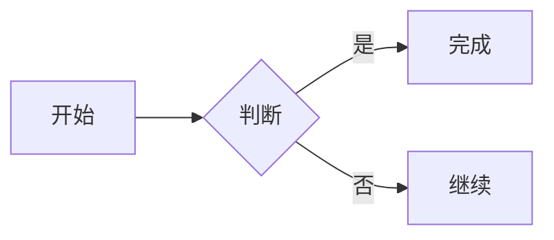

# Markdown 扩展

## 数学公式

行内公式用单个美元符号，行间公式用两个：

```markdown
质能方程 $E = mc^2$。

$$
\int_0^1 x^2 \, dx = \frac{1}{3}
$$
```

为避免把货币金额误识别为公式，`$` 后不能紧跟空白、`$` 前不能有空白，且结束 `$` 后不能紧跟数字；需要字面美元符号时写作 `\$`。公式在浏览器端由 KaTeX 渲染，不读取任何外部字体或资源。

KaTeX 需要内联样式，因此 CSP 对 `style-src` 放开了 `'unsafe-inline'`；Markdown 原始 HTML 中的 `style` 会被 DOMPurify 移除，仅保留 KaTeX 自身生成的样式。

## 提示卡片与任务列表

支持 GitHub 风格的提示卡片：

```markdown
> [!WARNING]
> 这里是警告内容。

> [!TIP]
> 这里是提示内容。
```

可用类型：`NOTE`、`TIP`、`IMPORTANT`、`WARNING`、`CAUTION`。普通块引用不受影响。

GFM 任务列表：

```markdown
- [ ] 待办事项
- [x] 已完成事项
```

已完成项会显示勾选状态、弱化文字并加删除线。

## Mermaid 图表

在预览中直接渲染 Mermaid 代码块：

````markdown

````

Mermaid 仅在笔记包含 `mermaid` / `mmd` / `gantt` 代码块时按需加载，使用严格安全模式，支持 Mermaid 自带的流程图、时序图、类图、状态图、ER 图、甘特图、饼图、思维导图等图表类型。语法错误会显示在预览中的错误卡片里。

每个图表右上角都有一个切换按钮：点击可在渲染后的图表和 Mermaid 源码之间来回切换，默认显示图表。

## 甘特图

甘特图既可以写在 `mermaid` 代码块里（第一行是 `gantt`），也可以直接使用 `gantt` 代码块，此时不需要再写 `gantt` 关键字：

````markdown
```gantt
  title 项目排期
  dateFormat YYYY-MM-DD
  axisFormat %m-%d
  section 设计
  需求梳理 :done, a1, 2024-01-01, 10d
  视觉稿   :active, a2, after a1, 12d
  section 开发
  前端     :b1, after a2, 30d
  后端     :b2, after a2, 35d
  section 发布
  联调     :crit, c1, after b1, 8d
  上线     :c2, after c1, 3d
```
````

甘特图不会像其他图表那样缩放到容器宽度：它按自身的固定宽度渲染，容器内可横向滚动，避免长周期项目把文字挤到无法阅读。任务条按状态着色（`done`、`active`、`crit`、普通任务），浅色与深色主题各有一套配色。

