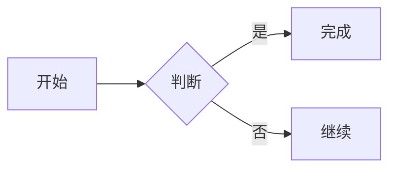

# Markdown 扩展

## 数学公式

行内公式用单个美元符号，行间公式用两个：

```markdown
质能方程 $E = mc^2$。

$$
\int_0^1 x^2 \, dx = \frac{1}{3}
$$
```

为避免把货币金额误识别为公式，`$` 后不能紧跟空白、`$` 前不能有空白，且结束 `$` 后不能紧跟数字；需要字面美元符号时写作 `\$`。公式在浏览器端由 KaTeX 渲染，不读取任何外部字体或资源。

KaTeX 需要内联样式，因此 CSP 对 `style-src` 放开了 `'unsafe-inline'`；Markdown 原始 HTML 中的 `style` 会被 DOMPurify 移除，仅保留 KaTeX 自身生成的样式。

## 提示卡片与任务列表

支持 GitHub 风格的提示卡片：

```markdown
> [!WARNING]
> 这里是警告内容。

> [!TIP]
> 这里是提示内容。
```

可用类型：`NOTE`、`TIP`、`IMPORTANT`、`WARNING`、`CAUTION`。普通块引用不受影响。

GFM 任务列表：

```markdown
- [ ] 待办事项
- [x] 已完成事项
```

已完成项会显示勾选状态、弱化文字并加删除线。

## Mermaid 图表

在预览中直接渲染 Mermaid 代码块：

````markdown

````

Mermaid 仅在笔记包含 `mermaid` / `mmd` 代码块时按需加载，使用严格安全模式，支持 Mermaid 自带的流程图、时序图、类图、状态图、ER 图、甘特图、饼图、思维导图等图表类型。语法错误会显示在预览中的错误卡片里。
